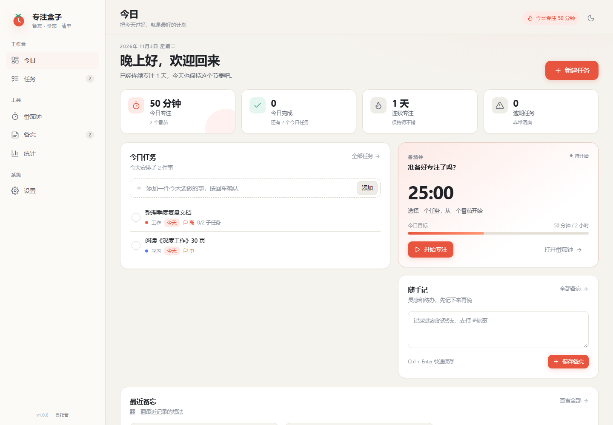

# 专注盒子 FocusBox

一个把 **备忘录**、**番茄钟** 与 **任务清单** 放在一起的中文自托管效率工具。它参考了 [Pomotroid](https://github.com/Splode/pomotroid)、[Memos](https://github.com/usememos/memos) 与 [Super Productivity](https://github.com/super-productivity/super-productivity) 的核心体验，适合部署在自己的电脑、NAS 或家庭服务器上。

所有数据保存在本地 SQLite 数据库中，不依赖外部服务、CDN 或云账号。界面与提示语均为简体中文。



> 上图使用示例数据展示，首次启动时只会包含三个默认项目与一条欢迎备忘。

## 功能特性

### 今日工作台
- 今日专注时长、完成番茄数、完成任务数、连续专注天数与逾期任务概览
- 当前日期落在「开始日期～截止日期」区间内的任务会显示在今日，可快速勾选完成或直接开始专注
- 快速添加今日任务
- 随手记备忘，支持 `Ctrl + Enter` 快捷保存
- 最近备忘预览与置顶标记

### 任务清单
- 项目分类（内置「工作 / 生活 / 学习」，可自行增删改）
- 优先级、开始日期（默认创建当天）、截止日期、预计时长、备注
- 子任务拆分、勾选与标题修改保存
- 手动记录投入时间，自动汇总番茄专注时长
- 按状态、项目、优先级筛选，支持关键词搜索
- 任务详情抽屉内编辑，点击「保存修改」按钮生效

### 番茄钟
- 专注 / 短休息 / 长休息三种模式
- 自定义专注时长、休息时长与长休息间隔
- 每日专注目标与进度环
- 自动开始休息 / 自动开始下一轮专注
- 完成提示音与桌面通知
- 计时状态写入 `localStorage`，刷新页面后可恢复
- 完成或提前结束的专注会记录到服务端，并同步到任务与统计

### 备忘
- Markdown 渲染：标题、加粗、斜体、删除线、高亮、行内代码、代码块、引用、列表、任务列表、链接
- `#标签` 自动提取与聚合
- 搜索、按标签筛选、置顶、归档、编辑与删除
- 首页最近备忘直达编辑

### 统计
- 最近 7 / 30 / 90 天专注趋势
- 专注热力图
- 任务完成概览
- 项目时间分布
- 日均专注、最佳一天、活跃天数、新增备忘等洞察

### 设置与数据
- 主题：浅色 / 深色 / 跟随系统
- 番茄钟参数与通知开关
- JSON 全量导出 / 导入
- 一键恢复初始示例数据
- 数据持久化到 Docker 卷
- 可选登录 / 退出登录：设置 `FOCUSBOX_USERNAME` / `FOCUSBOX_PASSWORD` 后启用；浏览器登录页只需用户名和密码，安卓客户端登录页额外填写服务器 IP，退出登录后可更换服务器或账号；飞牛安装包会在安装向导中自动配置

## 技术栈

| 层次 | 技术 |
| --- | --- |
| 运行时 | Node.js 24+ |
| Web 框架 | Express 4 |
| 数据库 | Node.js 内置 `node:sqlite`（SQLite） |
| 前端 | 原生 ES Modules + 手写 CSS，无构建步骤、无 CDN |
| 部署 | Docker / Docker Compose |

## 快速开始

### 方式一：Docker Compose（推荐）

```bash
docker compose up -d --build
```

打开 <http://localhost:3000>。

停止服务：

```bash
docker compose down
```

数据保存在命名卷 `focusbox-data` 中，`docker compose down` 不会删除数据。若需连同数据一起删除：

```bash
docker compose down -v
```

### 方式二：直接使用 Docker 命令

```bash
docker build -t focusbox:1.0.5 .
docker run -d \
  --name focusbox \
  -p 3000:3000 \
  -v focusbox-data:/data \
  --restart unless-stopped \
  focusbox:1.0.5
```

### 方式三：使用已导出的镜像文件

如果当前目录的 `release/` 下已有 CI 导出的镜像 tar（例如 `focusbox-1.0.5-amd64.tar`）：

```bash
docker load -i release/focusbox-1.0.5-amd64.tar
docker run -d \
  --name focusbox \
  -p 3000:3000 \
  -v focusbox-data:/data \
  --restart unless-stopped \
  focusbox:1.0.5
```

如需启用登录：

```bash
docker run -d \
  --name focusbox \
  -p 3000:3000 \
  -v focusbox-data:/data \
  --restart unless-stopped \
  -e FOCUSBOX_USERNAME=admin \
  -e FOCUSBOX_PASSWORD=你的密码 \
  focusbox:1.0.5
```

### 方式四：飞牛 fnOS（.fpk 安装包）

GitHub Actions 会构建多架构镜像并推送到 GHCR，同时产出轻量安装包 `focusbox-fnos-<版本>.fpk`。fpk 只包含生命周期脚本、向导和图标，不内置镜像；安装时会从 `ghcr.io/nickkk333/focusbox:<版本>` 拉取对应架构的镜像，因此安装包体积很小，但 NAS 需要能访问 `ghcr.io`。

在飞牛应用中心 → 手动安装，选择 fpk。安装向导会要求填写：

- 用户名（默认 `admin`）
- 密码
- Web 访问端口（默认 `8083`）

数据目录固定为 `/vol1/@appshare/focusbox`，安装时无需选择。安装完成后可从飞牛桌面图标打开，或访问 `http://飞牛IP:8083`。

> 安装包会创建名为 `focusbox` 的 Docker 容器，并通过安装向导填写的用户名、密码启用登录页。若需要公网访问，请在前面再加一层 HTTPS 反向代理。
>
> 首次发布后，请到 GitHub 仓库的 Packages 页面确认 `focusbox` 包可见性为 **Public**；否则 fnOS 无法匿名拉取镜像。工作流会尝试自动设置，若失败请手动修改。

### 方式五：安卓客户端（APK）

仓库的 `android/` 目录包含一个轻量 WebView 客户端。登录页填写服务器 IP / 地址、用户名和密码；顶部菜单可「退出登录」，退出后回到登录页重新填写服务器 IP 即可更换服务器或账号。登录后与在手机浏览器中访问同一地址完全一致，可以查看和修改全部数据，也支持任务、备忘、统计、设置以及 JSON 备份的导入 / 导出。

推送 `v*` tag 时，GitHub Actions 会使用 Android SDK 自动构建 APK，并附加到对应的 GitHub Release：

```text
focusbox-android-<版本>.apk
focusbox-android-<版本>.apk.sha256
```

直接到 Releases 页面下载安装即可。仓库中已包含 CI 签名密钥 `android/keystore/focusbox.jks`（store password / key password 均为 `focusbox`），仅用于保证后续 APK 可以覆盖安装，不用于保护任何服务器数据。

如需本地构建（可选）：

```powershell
$env:ANDROID_SDK_ROOT = "<Android SDK 路径>"
$env:JAVA_HOME = "<JDK 17 路径>"
powershell -ExecutionPolicy Bypass -File android\build.ps1
```

输出为 `android/dist/focusbox-android-<版本>.apk`。详细说明见 [`android/README.md`](android/README.md)。

安装后在登录页输入例如 `http://192.168.1.20:8083`、安装向导中设置的用户名和密码即可。若服务器未启用登录，用户名和密码可以留空。局域网可以直接使用 HTTP；公网访问请在服务器前配置 HTTPS 反向代理。

### 方式六：本地开发运行

要求 Node.js **24 或更高版本**（使用内置 `node:sqlite`）。

```bash
npm ci
npm start
```

开发模式（文件变更自动重启）：

```bash
npm run dev
```

默认地址：<http://localhost:3000>。本地数据写入项目下的 `data/focusbox.db`。

## GitHub Actions 构建与发布

工作流位于 `.github/workflows/release.yml`。推送到 `main`、推送 `v1.2.3` 形式的 tag，或在 Actions 页面手动触发 `Build and Release`，都会构建多架构镜像并推送到 GHCR，同时上传以下产物：

- `focusbox-<版本>-amd64.tar`：amd64 Docker 镜像
- `focusbox-<版本>-arm64.tar`：arm64 Docker 镜像
- `focusbox-fnos-<版本>.fpk`：飞牛 fnOS 轻量安装包（安装时从 GHCR 拉取镜像）
- `focusbox-fnos-<版本>.fpk.sha256`：安装包校验和
- `focusbox-android-<版本>.apk`：安卓客户端
- `focusbox-android-<版本>.apk.sha256`：APK 校验和

镜像地址为 `ghcr.io/nickkk333/focusbox:<版本>` 和 `ghcr.io/nickkk333/focusbox:latest`。tag 推送会自动创建 GitHub Release；手动触发时可勾选 `publish` 创建 Release。工作流还会启动 amd64 镜像做健康检查、数据目录权限与登录/登出冒烟测试。

## 配置项

| 环境变量 | 默认值 | 说明 |
| --- | --- | --- |
| `PORT` | `3000` | HTTP 监听端口 |
| `HOST` | `0.0.0.0` | HTTP 监听地址 |
| `DATA_DIR` | 项目下 `data/` | 数据目录；Docker 镜像默认为 `/data` |
| `DB_FILE` | `$DATA_DIR/focusbox.db` | 可单独指定 SQLite 文件路径 |
| `FOCUSBOX_USERNAME` | 空 | 可选。设置后与密码一起启用登录页与退出登录 |
| `FOCUSBOX_PASSWORD` | 空 | 可选。设置后与用户名一起启用登录页与退出登录 |
| `FOCUSBOX_FRAME_ANCESTORS` | `'self'` | 允许嵌入页面的来源；飞牛安装包会设为 `'self' http: https:` |
| `FOCUSBOX_DATA_DIR` | `/vol1/@appshare/focusbox` | 仅飞牛安装包使用，覆盖宿主机数据目录 |
| `FOCUSBOX_IMAGE_REPO` | `ghcr.io/nickkk333/focusbox` | 仅飞牛安装包使用，覆盖镜像仓库 |
| `FOCUSBOX_IMAGE` | 空 | 仅飞牛安装包使用，直接指定完整镜像名（优先级最高） |
| `TZ` | 系统时区 | 容器时区，例如 `Asia/Shanghai` |

Compose 中修改端口示例：

```yaml
ports:
  - "8080:3000"
```

## 数据持久化与备份

### Docker 命名卷

镜像将数据目录声明为 `/data`。使用命名卷时，数据库文件位于卷内的 `focusbox.db`。容器重建或升级不会影响数据。

### 绑定挂载到宿主机

```yaml
volumes:
  - ./data:/data
```

Linux 下如果遇到权限问题，可先让容器用户（UID 1000）拥有目录：

```bash
mkdir -p ./data
sudo chown -R 1000:1000 ./data
```

### 应用内备份

进入「设置 → 数据管理」：

- **导出**：下载包含项目、任务、子任务、时间记录、备忘、番茄记录与设置的 JSON 文件
- **导入**：覆盖现有数据并从备份恢复
- **清空数据**：删除全部数据并恢复初始示例内容

也可以直接访问 `GET /api/data/export` 下载备份。

## 目录结构

```text
.
├── .github/
│   └── workflows/
│       └── release.yml       # 构建并推送镜像、打包 fnOS fpk 并发布
├── android/
│   ├── src/                  # MainActivity（WebView + 登录/登出页）
│   ├── res/                  # 图标、主题、字符串
│   ├── AndroidManifest.xml
│   └── build.ps1             # 本地 APK 构建脚本
├── deploy/
│   └── fnos/                 # 飞牛 fnOS 应用包源
│       ├── manifest
│       ├── cmd/              # 安装、启停、升级生命周期脚本
│       ├── config/           # 权限与资源声明
│       ├── wizard/           # 安装向导（用户名、密码、端口）
│       ├── app/ui/           # 桌面入口与图标
│       └── build.sh          # 本地 / CI 打包脚本
├── Dockerfile
├── docker-entrypoint.sh       # 修正 /data 权限后降权运行
├── docker-compose.yml
├── LICENSE
├── README.md
├── package.json
├── package-lock.json
├── server/
│   ├── index.js              # Express 入口、静态资源与错误处理
│   ├── db.js                 # SQLite 表结构、设置与事务
│   ├── seed.js               # 首次启动示例数据
│   ├── utils.js              # 参数校验与数据映射
│   └── routes/
│       ├── projects.js       # 项目
│       ├── tasks.js          # 任务、子任务、时间记录
│       ├── memos.js          # 备忘与标签
│       ├── sessions.js       # 番茄记录、统计、徽标
│       ├── settings.js       # 设置
│       └── data.js           # 导入、导出、重置
└── public/
    ├── index.html
    ├── favicon.svg
    ├── css/
    │   ├── base.css          # 设计变量与通用组件
    │   ├── layout.css        # 应用外壳与响应式布局
    │   └── views.css         # 各业务视图
    └── js/
        ├── app.js            # 外壳、导航、主题、徽标
        ├── router.js         # Hash 路由
        ├── timer.js          # 番茄计时状态机
        ├── markdown.js       # 安全的 Markdown 渲染
        ├── components.js     # 弹窗、抽屉、Toast 等
        ├── api.js
        ├── utils.js
        └── views/            # 今日、任务、番茄钟、备忘、统计、设置
```

## API 概览

所有接口均返回 JSON，错误格式为 `{ "error": "中文错误信息" }`。

| 方法 | 路径 | 说明 |
| --- | --- | --- |
| GET | `/api/health` | 健康检查（匿名） |
| GET | `/api/auth/status` | 当前登录状态（匿名） |
| POST | `/api/auth/login` | 用户名密码登录，签发会话 Cookie（匿名） |
| POST | `/api/auth/logout` | 退出登录并撤销会话（匿名） |
| GET / POST | `/api/projects` | 项目列表 / 新建项目 |
| PATCH / DELETE | `/api/projects/:id` | 更新 / 删除项目 |
| GET | `/api/tasks` | 任务列表，支持 `status`、`projectId`、`priority`、`due`、`search`、`date`；`due=today` 表示当天落在开始日期～截止日期区间内 |
| POST | `/api/tasks` | 新建任务，未传 `startDate` 时默认为创建当天 |
| GET / PATCH / DELETE | `/api/tasks/:id` | 任务详情 / 更新 / 删除，支持 `startDate` |
| POST | `/api/tasks/:id/toggle` | 切换完成状态 |
| POST | `/api/tasks/:id/subtasks` | 新建子任务 |
| PATCH / DELETE | `/api/tasks/subtasks/:id` | 修改标题或完成状态 / 删除子任务 |
| POST | `/api/tasks/:id/time` | 手动记录投入时间 |
| DELETE | `/api/tasks/time/:id` | 删除时间记录 |
| GET / POST | `/api/memos` | 备忘列表 / 新建备忘 |
| GET | `/api/memos/tags` | 标签聚合 |
| PATCH / DELETE | `/api/memos/:id` | 更新 / 删除备忘 |
| GET / POST | `/api/sessions` | 番茄记录列表 / 新建记录 |
| DELETE | `/api/sessions/:id` | 删除番茄记录 |
| GET | `/api/stats` | 统计，支持 `days`、`date`、`tzOffset` |
| GET | `/api/badges` | 侧栏徽标与今日专注摘要 |
| GET / PATCH | `/api/settings` | 读取 / 更新设置 |
| GET | `/api/data/export` | 导出 JSON 备份 |
| POST | `/api/data/import` | 导入 JSON 备份 |
| POST | `/api/data/reset` | 清空并恢复示例数据 |

## 设计说明

- **单用户、默认无登录**：这是面向个人自托管的工具，默认不包含账号体系。设置 `FOCUSBOX_USERNAME` 与 `FOCUSBOX_PASSWORD` 后会启用登录（飞牛安装包会自动设置）：浏览器登录页只填用户名和密码，安卓客户端登录页多一个服务器 IP / 地址字段，退出登录后回到登录页即可换服务器或账号。登录使用服务端会话（HttpOnly Cookie，30 天有效），登出会立即撤销会话；同时保留 HTTP Basic 校验以兼容旧版客户端与自动化脚本。请勿把未加保护的服务直接暴露到公网；如需远程访问，建议再放在带 HTTPS 的反向代理（如 Nginx、Caddy、Authelia）之后。
- **计时在浏览器端运行**：刷新页面后通过 `localStorage` 恢复；关闭所有页面后计时不会在后台继续。专注完成后由浏览器向服务端写入记录。
- **时区**：统计接口接收浏览器传入的 `tzOffset`，按本地日期聚合数据，避免跨时区导致「今天」错位。
- **静态资源缓存**：服务端对静态文件使用 `no-cache` + ETag 协商缓存，升级镜像后刷新页面即可拿到新版本。

## 常见问题

**Q：页面一直停在启动画面？**  
打开浏览器开发者工具查看控制台。若提示无法连接服务器，请确认容器状态与端口映射：`docker ps`、`docker logs focusbox`。

**Q：启动时报 `unable to open database file`？**  
容器入口会以 root 修正 `/data` 权限后降权到 `node` 运行。若仍出现该错误，请确认 `/vol1/@appshare/focusbox` 所在存储卷可写，并查看 `docker logs focusbox` 以及 `/var/apps/focusbox/var/focusbox-main.log`。

**Q：桌面通知没有出现？**  
浏览器通知通常要求 HTTPS 或 `localhost` 环境，并且需要用户授权。首次开启时请允许通知权限。

**Q：如何升级？**

```bash
docker compose build --pull
docker compose up -d
```

数据卷保持不变，升级后刷新浏览器即可。

**Q：如何修改时区？**  
在 `docker-compose.yml` 中调整 `TZ`，例如 `Asia/Shanghai`，然后重新启动容器。

**Q：可以在 ARM 设备（如树莓派、部分 NAS）上运行吗？**  
可以。`node:24-alpine` 提供多架构镜像，在目标设备上执行 `docker build` 或使用对应架构的镜像即可。

## 参考项目

- [Pomotroid](https://github.com/Splode/pomotroid)：简洁的番茄钟体验与计时交互
- [Memos](https://github.com/usememos/memos)：轻量、自托管的碎片化笔记
- [Super Productivity](https://github.com/super-productivity/super-productivity)：任务、时间盒与工作流整合

本项目为学习与自用目的独立实现，未复制上述项目的源代码。

## 许可证

[MIT](./LICENSE)
