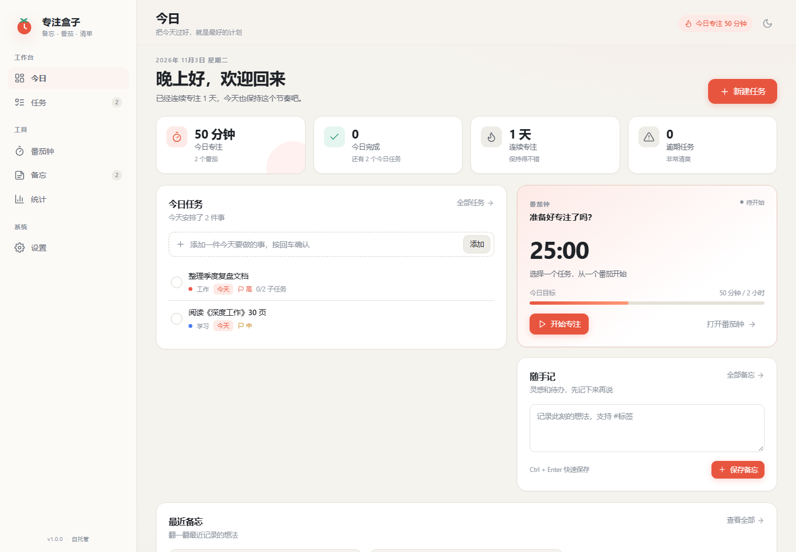

# 专注盒子 FocusBox

一个把 **备忘录**、**番茄钟** 与 **任务清单** 放在一起的中文自托管效率工具。它参考了 [Pomotroid](https://github.com/Splode/pomotroid)、[Memos](https://github.com/usememos/memos) 与 [Super Productivity](https://github.com/super-productivity/super-productivity) 的核心体验，适合部署在自己的电脑、NAS 或家庭服务器上。

所有数据保存在本地 SQLite 数据库中，不依赖外部服务、CDN 或云账号。界面与提示语均为简体中文。



> 上图使用示例数据展示，首次启动时只会包含三个默认项目与一条欢迎备忘。

## 功能特性

### 今日工作台
- 今日专注时长、完成番茄数、完成任务数、连续专注天数与逾期任务概览
- 当前日期落在「开始日期～截止日期」区间内的任务会显示在今日，可快速勾选完成或直接开始专注
- 快速添加今日任务
- 随手记备忘，支持 `Ctrl + Enter` 快捷保存
- 最近备忘预览与置顶标记

### 任务清单
- 支持「单次任务」与「每日打卡任务」：单次任务完成后结束，每日打卡任务在开始～结束日期之间每天出现
- 每日打卡任务可在详情日历中查看每天的打卡情况，并随时补看已打卡 / 未打卡日期
- 项目分类（内置「工作 / 生活 / 学习」，可自行增删改）
- 优先级、开始日期（默认创建当天）、截止日期、预计时长、备注
- 子任务拆分、勾选与标题修改保存
- 手动记录投入时间，自动汇总番茄专注时长
- 按状态、项目、优先级筛选，支持关键词搜索
- 任务详情抽屉内编辑自动保存（600ms 防抖），也可点击「保存修改」立即保存；子任务标题改完点击行内保存按钮

### 番茄钟
- 专注 / 短休息 / 长休息三种模式
- 自定义专注时长、休息时长与长休息间隔
- 每日专注目标与进度环
- 自动开始休息 / 自动开始下一轮专注
- 完成提示音与桌面通知
- 计时状态写入 `localStorage`，刷新页面后可恢复
- 完成或提前结束的专注会记录到服务端，并同步到任务与统计

### 备忘
- Markdown 渲染：标题、加粗、斜体、删除线、高亮、行内代码、代码块、引用、列表、任务列表、链接
- `#标签` 自动提取与聚合
- 搜索、按标签筛选、置顶、归档、编辑与删除
- 首页最近备忘直达编辑

### 统计
- 最近 7 / 30 / 90 天专注趋势
- 专注热力图
- 任务完成概览
- 项目时间分布
- 日均专注、最佳一天、活跃天数、新增备忘等洞察

### 设置与数据
- 主题：浅色 / 深色 / 跟随系统
- 番茄钟参数与通知开关
- JSON 全量导出 / 导入（备份格式 v2，包含任务类型与每日打卡记录；旧版备份可直接导入）
- 一键恢复初始示例数据
- 数据持久化到 Docker 卷
- 可选登录 / 退出登录：设置 `FOCUSBOX_USERNAME` / `FOCUSBOX_PASSWORD` 后启用；浏览器登录页只需用户名和密码，安卓客户端登录页额外填写服务器 IP，退出登录后可更换服务器或账号；飞牛安装包会在安装向导中自动配置

## 技术栈

| 层次 | 技术 |
| --- | --- |
| 运行时 | Node.js 24+ |
| Web 框架 | Express 4 |
| 数据库 | Node.js 内置 `node:sqlite`（SQLite） |
| 前端 | 原生 ES Modules + 手写 CSS，无构建步骤、无 CDN |
| 测试 | Node.js 内置 `node:test`（无第三方测试依赖） |
| 部署 | Docker / Docker Compose |

服务端按「启动编排 → 应用组装 → 领域模块 → 数据库」分层：`createApp(context)` 只组装 Express，不监听端口、不读环境变量、不打开数据库，因此测试可以用临时数据库完整驱动所有 HTTP 接口。所有取值（颜色、字号、间距、圆角、动效、层级）集中在 `public/css/tokens.css`，组件样式不写死色值。

## 快速开始

### 方式一：Docker Compose（推荐）

```bash
docker compose up -d --build
```

打开 <http://localhost:8082>。

停止服务：

```bash
docker compose down
```

数据保存在命名卷 `focusbox-data` 中，`docker compose down` 不会删除数据。若需连同数据一起删除：

```bash
docker compose down -v
```

### 方式二：直接使用 Docker 命令

```bash
docker build -t focusbox:1.0.7 .
docker run -d \
  --name focusbox \
  -p 8082:8082 \
  -v focusbox-data:/data \
  --restart unless-stopped \
  focusbox:1.0.7
```

### 方式三：使用已导出的镜像文件

如果当前目录的 `release/` 下已有 CI 导出的镜像 tar（例如 `focusbox-1.0.7-amd64.tar`）：

```bash
docker load -i release/focusbox-1.0.7-amd64.tar
docker run -d \
  --name focusbox \
  -p 8082:8082 \
  -v focusbox-data:/data \
  --restart unless-stopped \
  focusbox:1.0.7
```

如需启用登录：

```bash
docker run -d \
  --name focusbox \
  -p 8082:8082 \
  -v focusbox-data:/data \
  --restart unless-stopped \
  -e FOCUSBOX_USERNAME=admin \
  -e FOCUSBOX_PASSWORD=你的密码 \
  focusbox:1.0.7
```

### 方式四：飞牛 fnOS（.fpk 安装包）

fpk 是**纯数据服务端**：只提供安卓客户端需要的 `/api/*`，不分发网页前端（界面已内置在 APK 里）。从飞牛桌面图标或 `http://飞牛IP:8083` 打开的是一个极简服务状态页，不是应用界面。

安装包随包携带服务端源码与专用 `Dockerfile.api`，镜像准备按以下顺序自动回退，不强依赖 GHCR：

1. 已存在 `focusbox-api:<版本>` 镜像 → 直接启动
2. 数据目录里有离线镜像 tar → `docker load` 导入。可直接把 CI Release 里的 `focusbox-<版本>-amd64.tar` / `-arm64.tar` 按架构放入 `/vol1/@appshare/focusbox/`，或改名为 `focusbox-api-<版本>.tar`；脚本会自动把 tar 内的 `focusbox:<版本>` 重命名为 `focusbox-api:<版本>`
3. 用 fpk 自带的构建上下文在 NAS 本地 `docker build`（需能拉取 `node:24-alpine` 基础镜像）
4. 兜底从 GHCR 拉取同版本镜像并打上本地标签

容器启动时设置 `FOCUSBOX_API_ONLY=1`，因此关闭网页前端、启用 CORS，只保留数据 API。安装向导会要求填写：

- 用户名（默认 `admin`）
- 密码
- 数据服务端口（默认 `8083`）

数据目录固定为 `/vol1/@appshare/focusbox`。本地构建包：

```bash
FNPACK_BIN=/path/to/fnpack ./deploy/fnos/build.sh 1.1.1 release
```

产物为 `release/focusbox-fnos-<版本>.fpk` 与 `.sha256`（脚本会修正 Windows 版 `fnpack` 丢失的生命周期脚本执行位）。若需要公网访问，请在前面加一层 HTTPS 反向代理。

### 方式五：安卓客户端（APK）

应用界面（HTML / CSS / ES Modules）随 APK 安装，**不需要从服务器下载**。首次启动选择数据源，之后可从菜单随时切换：

| 模式 | 数据位置 | 说明 |
| --- | --- | --- |
| 从服务器获取数据 | 飞牛 fpk / 自托管服务端 | 填写 `http://飞牛IP:8083` 与安装向导的用户名、密码 |
| 本机作为服务器 | 手机 WebView 的 localStorage | 完全离线，内置 JS 数据层复刻全部 API |

两种模式共用同一套界面、同一份 `/api/*` 契约与 v2 备份格式，备份文件可互相导入导出。服务器模式用 HTTP Basic 逐请求认证（服务端 API-only 模式提供 CORS 与预检支持），本机模式不发任何网络请求。

实现要点：WebView 在虚拟源 `https://focusbox.app/` 下由 `shouldInterceptRequest` 提供内置资源（避免 `file://` 下 ES Modules 被 CORS 阻止）；注入的 `native-bridge.js` 在前端之前安装 `fetch` 垫片，按模式把 `/api/*` 分派到远端或内置 `local-api.js`。前端源码不需要为安卓写任何条件分支。

推送 `v*` tag 时，GitHub Actions 会构建 APK 与 fpk 并附加到 Release：

```text
focusbox-android-<版本>.apk
focusbox-android-<版本>.apk.sha256
focusbox-fnos-<版本>.fpk
focusbox-fnos-<版本>.fpk.sha256
```

本地构建（需要 JDK 17 + Android SDK 34；放在项目 `.tools/` 下会被自动识别）：

```powershell
powershell -ExecutionPolicy Bypass -File android\build.ps1
```

```bash
./android/build.sh   # Linux / macOS / CI
```

输出为 `android/dist/focusbox-android-<版本>.apk`。仓库中已包含自签名更新密钥 `android/keystore/focusbox.jks`（口令均为 `focusbox`），仅用于保证覆盖安装。安装说明、数据容量限制与迁移方式见 [`android/README.md`](android/README.md)。

### 方式六：本地开发运行

要求 Node.js **24 或更高版本**（使用内置 `node:sqlite`）。

```bash
npm ci
npm start
```

开发模式（文件变更自动重启）：

```bash
npm run dev
```

运行测试（接口集成 + API-only 模式 + 领域模块 + 前端状态/请求层 + 安卓离线数据层，共 52 项）：

```bash
npm test
```

测试使用系统临时目录中的独立 SQLite 文件与随机端口，不会读写 `data/` 下的真实数据，结束后自动清理。

默认地址：<http://localhost:8082>。本地数据写入项目下的 `data/focusbox.db`。

## GitHub Actions 构建与发布

工作流位于 `.github/workflows/release.yml`。推送到 `main`、推送 `v1.2.3` 形式的 tag，或在 Actions 页面手动触发 `Build and Release`，都会构建多架构镜像并推送到 GHCR，同时上传以下产物：

- `focusbox-<版本>-amd64.tar`：amd64 Docker 镜像（完整 Web 版；放入飞牛数据目录可作为 fpk 的离线导入源，运行时由 `FOCUSBOX_API_ONLY=1` 切成纯数据服务）
- `focusbox-<版本>-arm64.tar`：arm64 Docker 镜像
- `focusbox-fnos-<版本>.fpk`：飞牛 fnOS 数据服务安装包（自带服务端构建上下文，可离线构建镜像）
- `focusbox-fnos-<版本>.fpk.sha256`：安装包校验和
- `focusbox-android-<版本>.apk`：安卓客户端
- `focusbox-android-<版本>.apk.sha256`：APK 校验和

镜像地址为 `ghcr.io/nickkk333/focusbox:<版本>` 和 `ghcr.io/nickkk333/focusbox:latest`。tag 推送会自动创建 GitHub Release；手动触发时可勾选 `publish` 创建 Release。工作流还会启动 amd64 镜像做健康检查、数据目录权限与登录/登出冒烟测试。

## 配置项

| 环境变量 | 默认值 | 说明 |
| --- | --- | --- |
| `PORT` | `8082` | HTTP 监听端口 |
| `HOST` | `0.0.0.0` | HTTP 监听地址 |
| `DATA_DIR` | 项目下 `data/` | 数据目录；Docker 镜像默认为 `/data` |
| `DB_FILE` | `$DATA_DIR/focusbox.db` | 可单独指定 SQLite 文件路径 |
| `FOCUSBOX_USERNAME` | 空 | 可选。设置后与密码一起启用登录 |
| `FOCUSBOX_PASSWORD` | 空 | 可选。设置后与用户名一起启用登录 |
| `FOCUSBOX_API_ONLY` | `false` | 设为 `1` / `true` 时只提供 `/api/*` 与一个状态页，不服务前端静态资源；启用 CORS 与 OPTIONS 预检，供安卓客户端跨域访问 |
| `FOCUSBOX_FRAME_ANCESTORS` | `'self'` | 允许嵌入页面的来源；飞牛安装包会设为 `'self' http: https:` |
| `FOCUSBOX_DATA_DIR` | `/vol1/@appshare/focusbox` | 仅飞牛安装包使用，覆盖宿主机数据目录 |
| `FOCUSBOX_IMAGE_REPO` | `focusbox-api` | 仅飞牛安装包使用，本地镜像仓库名 |
| `FOCUSBOX_IMAGE_TAG` | fpk 版本 | 仅飞牛安装包使用，覆盖本地镜像标签 |
| `FOCUSBOX_IMAGE` | 空 | 仅飞牛安装包使用，直接指定完整镜像名（优先级最高） |
| `FOCUSBOX_GHCR_IMAGE` | `ghcr.io/nickkk333/focusbox:<版本>` | 仅飞牛安装包使用，兜底拉取的镜像 |
| `TZ` | 系统时区 | 容器时区，例如 `Asia/Shanghai` |

Compose 中修改端口示例：

```yaml
ports:
  - "8082:8082"
```

## 数据持久化与备份

### Docker 命名卷

镜像将数据目录声明为 `/data`。使用命名卷时，数据库文件位于卷内的 `focusbox.db`。容器重建或升级不会影响数据。

### 绑定挂载到宿主机

```yaml
volumes:
  - ./data:/data
```

Linux 下如果遇到权限问题，可先让容器用户（UID 1000）拥有目录：

```bash
mkdir -p ./data
sudo chown -R 1000:1000 ./data
```

### 应用内备份

进入「设置 → 数据管理」：

- **导出**：下载包含项目、任务、子任务、时间记录、备忘、番茄记录与设置的 JSON 文件
- **导入**：覆盖现有数据并从备份恢复
- **清空数据**：删除全部数据并恢复初始示例内容

也可以直接访问 `GET /api/data/export` 下载备份。

## 目录结构

```text
.
├── .github/
│   └── workflows/
│       └── release.yml       # 构建并推送镜像、打包 fnOS fpk 并发布
├── android/
│   ├── src/                  # MainActivity（模式选择、资源拦截、原生桥接）
│   ├── assets/
│   │   ├── app/              # 内置前端（public/ 的副本，随 APK 安装）
│   │   └── bridge/
│   │       ├── native-bridge.js  # fetch 垫片：按模式分派 /api/*
│   │       └── local-api.js      # 纯浏览器离线 API（localStorage 持久化）
│   ├── res/                  # 图标、主题、字符串
│   ├── keystore/             # 自签名更新密钥
│   ├── AndroidManifest.xml
│   ├── build.ps1 / build.sh  # 本地 / CI APK 构建脚本
│   └── README.md
├── deploy/
│   └── fnos/                 # 飞牛 fnOS 数据服务应用包源
│       ├── manifest
│       ├── Dockerfile.api    # 只含 server/ 的 API-only 镜像定义
│       ├── cmd/              # 安装、启停、升级生命周期脚本（含本地构建镜像）
│       ├── config/           # 权限与资源声明
│       ├── wizard/           # 安装向导（用户名、密码、端口）
│       ├── app/ui/           # 桌面状态页入口与图标
│       └── build.sh          # 组装镜像上下文 + fnpack 打包 + 权限修正
├── Dockerfile
├── docker-entrypoint.sh       # 修正 /data 权限后降权运行
├── docker-compose.yml
├── LICENSE
├── README.md
├── package.json
├── package-lock.json
├── server/
│   ├── index.js              # 启动编排：配置 → 数据库 → seed → 监听 → 优雅关闭
│   ├── config.js             # 集中读取环境变量与版本号
│   ├── database.js           # 连接、建表、索引、旧库迁移、事务
│   ├── context.js            # 唯一的依赖组装点
│   ├── app.js                # createApp(context)：只组装 Express，无副作用
│   ├── http.js               # 安全头、404、错误处理等横切关注点
│   ├── auth.js               # 会话 / Cookie / Basic 认证
│   ├── seed.js               # 首次启动示例数据
│   ├── utils.js              # 纯函数：参数校验、数据映射、日期片段
│   ├── domain/               # 深模块（业务实现藏在几个方法之后）
│   │   ├── settings.js       # 设置的默认值、校验与读写
│   │   ├── overview.js       # 统计、徽标与任务计数（两接口共用）
│   │   └── backup.js         # 导出 / 导入 / 重置
│   └── routes/
│       ├── index.js          # 集中挂载与认证顺序
│       ├── projects.js       # 项目
│       ├── tasks.js          # 任务、子任务、时间记录
│       ├── memos.js          # 备忘与标签
│       ├── sessions.js       # 番茄记录
│       ├── settings.js       # 设置
│       └── data.js           # 导入、导出、重置
├── test/
│   ├── api.test.js           # HTTP 接口集成测试（含认证路径）
│   ├── api-only.test.js      # 纯数据服务模式、CORS 与 Basic 认证
│   ├── domain.test.js        # 设置 / 统计 / 备份领域测试
│   ├── frontend.test.mjs     # 前端状态与请求层测试
│   └── local-api.test.mjs    # 安卓内置离线数据层测试
└── public/
    ├── index.html
    ├── favicon.svg
    ├── css/
    │   ├── tokens.css        # 设计契约：原语 → 语义 → 尺度（唯一取值来源）
    │   ├── base.css          # 基础样式与通用组件
    │   ├── layout.css        # 外壳、导航、布局与专注模式
    │   └── views.css         # 各业务视图与响应式
    └── js/
        ├── app.js            # 启动编排：登录 → 外壳 → 设置/计时器 → 路由
        ├── router.js         # Hash 路由（视图只暴露 render）
        ├── timer.js          # 番茄计时状态机
        ├── theme.js          # 主题偏好（浏览器 chrome 颜色取自 tokens.css）
        ├── markdown.js       # 安全的 Markdown 渲染
        ├── components.js     # 弹窗、抽屉、Toast 等
        ├── api.js            # 请求层，抛出带状态码的 ApiError
        ├── utils.js
        ├── icons.js
        ├── bus.js            # 事件信号（状态变更已改由 store 承载）
        ├── core/
        │   ├── store.js      # 单一状态源：get / patch / subscribe
        │   └── dom.js        # 可卸载的事件绑定与委托
        ├── ui/
        │   └── shell.js      # 外壳模块：mount / update / destroy
        └── views/            # 今日、任务、番茄钟、备忘、统计、设置、登录
```

## 架构约定

后端按「小接口、深实现」组织，调用方只需知道少数几个方法：

| 模块 | 接口 | 藏在后面的是什么 |
| --- | --- | --- |
| `loadConfig(env)` | 一个函数 | 全部环境变量、默认值、版本号 |
| `openDatabase({ file })` | `{ db, tx, close, file }` | 建表、索引、PRAGMA、旧库补列迁移、事务 |
| `createContext({ config, database })` | 一组已装配好的模块 | 唯一的依赖注入点，模块之间不互相 import |
| `createApp(context)` | Express app | 中间件顺序、静态资源、SPA fallback、错误处理；无监听、无 IO 副作用。`config.apiOnly` 为真时切换为「仅 API + 状态页 + CORS」 |
| `createLocalApi({ storage })` | `handle / snapshot / restore / reset` | 安卓本机模式的全部 `/api/*` 语义，以 v2 备份快照持久化在 localStorage |
| `settings` | `get / update / defaults` | 默认值合并、范围钳制、类型校验、事务写入 |
| `overview` | `taskCounts / badges / stats` | `/api/stats` 与 `/api/badges` 共用的全部统计 SQL 与时区换算 |
| `backup` | `snapshot / restore / reset` | 备份 v2 序列化、旧版兼容、清理顺序、设置恢复 |

每个 `server/routes/*.js` 都是 `(context) => Router` 工厂，路由只做参数解析与响应，业务逻辑不留在路由里。前端同理：`store` 用 `get / patch / subscribe` 承载全部共享状态，`shell` 用 `mount / update / destroy` 承载全部外壳 DOM，视图通过事件总线发信号而不直接改外壳。

三种运行形态共用同一套 API 契约：

| 形态 | 前端来源 | 服务端 | 数据 |
| --- | --- | --- | --- |
| 浏览器 / Docker 完整版 | 服务端 `public/` | `createApp(context)`（默认模式） | 服务端 SQLite |
| 飞牛 fpk 数据服务 | 不提供（仅状态页） | `createApp(context)`（`FOCUSBOX_API_ONLY=1`） | 服务端 SQLite |
| 安卓 APK 本机模式 | `assets/app/` | `assets/bridge/local-api.js` | 手机 localStorage |

安卓服务器模式则是「APK 内置前端 + fpk 数据服务」，通过 `native-bridge.js` 把相对 `/api/*` 改写为带 Basic 认证的跨域请求。所有 HTTP 路径、响应字段、状态码与备份 v2 格式在四种组合中保持一致。

## API 概览

所有接口均返回 JSON，错误格式为 `{ "error": "中文错误信息" }`。

| 方法 | 路径 | 说明 |
| --- | --- | --- |
| GET | `/api/health` | 健康检查（匿名） |
| GET | `/api/auth/status` | 当前登录状态（匿名） |
| POST | `/api/auth/login` | 用户名密码登录，签发会话 Cookie（匿名） |
| POST | `/api/auth/logout` | 退出登录并撤销会话（匿名） |
| GET / POST | `/api/projects` | 项目列表 / 新建项目 |
| PATCH / DELETE | `/api/projects/:id` | 更新 / 删除项目 |
| GET | `/api/tasks` | 任务列表，支持 `status`、`projectId`、`priority`、`due`、`search`、`date`；`due=today` 表示当天落在开始日期～截止日期区间内 |
| POST | `/api/tasks` | 新建任务，未传 `startDate` 时默认为创建当天 |
| GET / PATCH / DELETE | `/api/tasks/:id` | 任务详情 / 更新 / 删除，支持 `startDate` |
| POST | `/api/tasks/:id/toggle` | 切换完成状态 |
| POST | `/api/tasks/:id/subtasks` | 新建子任务 |
| PATCH / DELETE | `/api/tasks/subtasks/:id` | 修改标题或完成状态 / 删除子任务 |
| POST | `/api/tasks/:id/time` | 手动记录投入时间 |
| DELETE | `/api/tasks/time/:id` | 删除时间记录 |
| GET / POST | `/api/memos` | 备忘列表 / 新建备忘 |
| GET | `/api/memos/tags` | 标签聚合 |
| PATCH / DELETE | `/api/memos/:id` | 更新 / 删除备忘 |
| GET / POST | `/api/sessions` | 番茄记录列表 / 新建记录 |
| DELETE | `/api/sessions/:id` | 删除番茄记录 |
| GET | `/api/stats` | 统计，支持 `days`、`date`、`tzOffset` |
| GET | `/api/badges` | 侧栏徽标与今日专注摘要 |
| GET / PATCH | `/api/settings` | 读取 / 更新设置 |
| GET | `/api/data/export` | 导出 JSON 备份 |
| POST | `/api/data/import` | 导入 JSON 备份 |
| POST | `/api/data/reset` | 清空并恢复示例数据 |

## 设计说明

- **单用户、默认无登录**：这是面向个人自托管的工具，默认不包含账号体系。设置 `FOCUSBOX_USERNAME` 与 `FOCUSBOX_PASSWORD` 后会启用登录（飞牛安装包会自动设置）：浏览器使用服务端会话（HttpOnly Cookie，30 天有效）；安卓客户端在首次启动填写服务器地址与凭据，由桥接层改用 HTTP Basic 逐请求认证，以避开跨站 Cookie 限制。请勿把未加保护的服务直接暴露到公网；如需远程访问，建议再放在带 HTTPS 的反向代理（如 Nginx、Caddy、Authelia）之后。
- **计时在浏览器端运行**：刷新页面后通过 `localStorage` 恢复；关闭所有页面后计时不会在后台继续。专注完成后由浏览器向服务端写入记录。
- **时区**：统计接口接收浏览器传入的 `tzOffset`，按本地日期聚合数据，避免跨时区导致「今天」错位。
- **静态资源缓存**：服务端对静态文件使用 `no-cache` + ETag 协商缓存，升级镜像后刷新页面即可拿到新版本。
- **视觉方向**：沿用重构前的「暖米纸面 + 珊瑚红」配色（浅色 `#f5f3ee` / `#e8553f`，深色 `#15161a` / `#ff6b57`），浅米色侧栏与柔和投影。色值全部集中在 `public/css/tokens.css` 的原语层，语义层与尺度层沿用重构后的设计契约；浅色 / 深色 / 跟随系统共用一套语义变量，组件样式不写死色值，只改这一处即可整体换肤。
- **层级与无障碍**：首页四张指标卡不再等权重——「今日专注」是唯一的大数字，逾期任务用琥珀色条提示；关键数字使用等宽数字字体。正文使用高对比墨色，珊瑚红强调色用于按钮填充与大号数字；提供可见键盘焦点、跳转主内容链接、40px 图标按钮与 `prefers-reduced-motion` 支持。
- **窄屏**：侧栏在 960px 以下收为抽屉，快速添加表单的输入框允许收缩以保留提交按钮，主指标数字在 520px 以下降号并禁止折行；390px 视口无横向溢出。

## 常见问题

**Q：页面一直停在启动画面？**  
打开浏览器开发者工具查看控制台。若提示无法连接服务器，请确认容器状态与端口映射：`docker ps`、`docker logs focusbox`。

**Q：启动时报 `unable to open database file`？**  
容器入口会以 root 修正 `/data` 权限后降权到 `node` 运行。若仍出现该错误，请确认 `/vol1/@appshare/focusbox` 所在存储卷可写，并查看 `docker logs focusbox` 以及 `/var/apps/focusbox/var/focusbox-main.log`。

**Q：桌面通知没有出现？**  
浏览器通知通常要求 HTTPS 或 `localhost` 环境，并且需要用户授权。首次开启时请允许通知权限。

**Q：飞牛桌面图标打开只有一个状态页，没有应用界面？**

这是预期行为：fpk 是纯数据服务端，界面内置在安卓 APK 里。请在手机上安装 APK，选择「从服务器获取数据」并填写 `http://飞牛IP:端口` 与安装向导的用户名、密码。若仍连不上，检查容器日志 `/var/apps/focusbox/var/focusbox-main.log` 与防火墙端口。

**Q：安卓「本机作为服务器」模式的数据会同步到 NAS 吗？**

不会，该模式完全离线，数据只存在手机 WebView 的 localStorage。清除应用数据会一并删除，请定期用「导出备份」保存 JSON 文件；需要迁移时在目标模式里用「导入备份」恢复。

**Q：如何升级？**

```bash
docker compose build --pull
docker compose up -d
```

数据卷保持不变，升级后刷新浏览器即可。

**Q：如何修改时区？**  
在 `docker-compose.yml` 中调整 `TZ`，例如 `Asia/Shanghai`，然后重新启动容器。

**Q：可以在 ARM 设备（如树莓派、部分 NAS）上运行吗？**  
可以。`node:24-alpine` 提供多架构镜像，在目标设备上执行 `docker build` 或使用对应架构的镜像即可。

## 参考项目

- [Pomotroid](https://github.com/Splode/pomotroid)：简洁的番茄钟体验与计时交互
- [Memos](https://github.com/usememos/memos)：轻量、自托管的碎片化笔记
- [Super Productivity](https://github.com/super-productivity/super-productivity)：任务、时间盒与工作流整合

本项目为学习与自用目的独立实现，未复制上述项目的源代码。

## 许可证

[MIT](./LICENSE)
